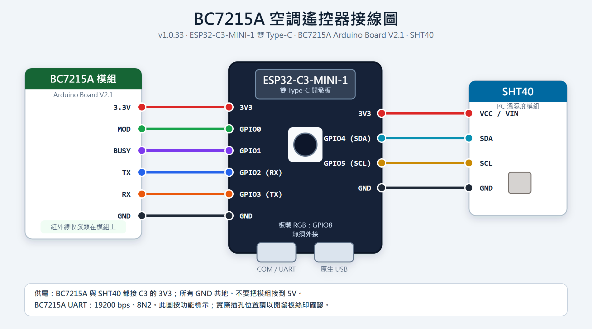

# BC7215A ESP32-C3 v1.0.33

ESP32-C3-MINI-1 雙 USB 開發板搭配 BC7215A，提供 ESPHome／Home Assistant、Matter 與本機網頁空調控制，以及 SHT40 溫濕度。

## 下載與快速開始

- **程式碼**：[下載完整專案 ZIP](https://github.com/shihkefa/BC7215_ESP32C3_ESPhome/archive/refs/heads/main.zip)，解壓後保留完整 `components/` 與 `web/` 資料夾。
- **已編譯 BIN**：[Factory／OTA 韌體與校驗碼](firmware/README.md)。新板使用 Factory，已安裝本專案 Matter 韌體時使用 OTA。
- **使用教學**：下方包含安裝、Wi-Fi 配網、遙控器匹配、HA、Matter、日常控制及完整燈號。
- **接線圖**：[PNG](接線圖.png)／[SVG](接線圖.svg)。
- **燒錄說明**：[Factory／OTA 安裝與升級](BIN_燒錄說明.md)。
- **版本紀錄**：[歷次更新](CHANGES.md)。
- **版本檢查**：[v1.0.33 驗證紀錄](VALIDATION.md)。

## 本版變更

本版重新檢查 v1.0.32 後，修正可用本機測試重現的收訊、配網與 Matter 問題：

- UART 同時排入多段資料時逐段保留，避免只剩最後一段；真實驅動測試涵蓋 1–4 段、32 次連按、分批到達、REV、跳脫字元與完成 ACK。
- 已連網時更換 Wi-Fi，會在 HTTP 回覆後延遲重新連線；AP 配網期間保留 AP，密碼錯誤仍可重新輸入。
- 網頁風速選單保持焦點時，也會反映裝置實際回報的風速。
- Matter 設為冷暖兼用，並在開機回報模式前修正舊版保存的 CoolingOnly 值，避免暖氣被 SDK 拒絕。
- Matter 尚未完成配對的暫存紀錄不計入已配對數；追加配對失敗回滾後，原手動視窗仍可顯示 QR 重試。
- 收到無效溫度值時，Matter 回報未知值，收到有效溫度後恢復。
- 沿用完整移除擺風的設計：HA、Matter、Web、學習按鈕／文字、學習綠閃與韌體樣本比對／發送流程均已刪除；風速、原廠遙控器同步與 SHT40 保留。

空調配對格式與儲存鍵、Matter 端點編號維持；不自動清除家庭。Wi-Fi 保存鍵依 ESPHome 設定版本產生，升級若回到 AP，需重新配網。舊獨立擺風資料不再讀取。

本版驗證與限制見 [VALIDATION.md](VALIDATION.md)。本機驗證不能保證所有品牌或長時間實機穩定，對未確認完成的紅外指令仍不自動重送。

## 接線

| C3 | 模組 |
|---|---|
| GPIO0 | BC7215A MOD |
| GPIO1 | BC7215A BUSY |
| GPIO2（RX） | BC7215A TX |
| GPIO3（TX） | BC7215A RX |
| 3.3V、GND | BC7215A 供電、共地 |
| GPIO4 | SHT40 SDA |
| GPIO5 | SHT40 SCL |
| 3.3V、GND | SHT40 供電、共地 |

附圖引腳已與 v1.0.33 YAML 逐項核對一致；開發板實際插孔位置請以板上絲印確認。

UART：19200、8N2；SHT40 位址 0x44；板載 RGB：GPIO8。預設日誌使用原生 USB_SERIAL_JTAG。若接 USB 轉串口插孔，可將 YAML 的 logger_uart 改為 UART0 後重新編譯。

## 安裝與升級

已有本專案 Matter 韌體，優先使用 `BC7215A_v1.0.33_Matter_ota_需配網.bin` 經 ESPHome OTA 更新。新板 USB 寫入使用 `BC7215A_v1.0.33_Matter_factory_需配網.bin`，起始位址 0x0。不要將 OTA 映像寫到 0x0。不需要先擦除 Flash／NVS。

更新後重新整理控制頁，確認頁尾為 v1.0.33。HA 會取得新的空調能力；舊學習按鈕或感測器若仍留在實體登錄中而顯示不可用，可在 HA 移除殘留實體。Matter 保持原空調端點 1；若 Apple 家庭仍快取舊擺葉控制，先等中樞重新連線。仍未更新時，才在該家庭移除此配件，於網頁手動開啟配對後重新加入。升級不會自動清空家庭。

## Wi-Fi 與控制頁

1. 未連網時，等待配網 AP 開啟，連上 `bc7215a-c3-xxxxxx`（MAC 最後 6 碼），密碼 **12345678**。
2. 開啟 `http://192.168.4.1/`，在「Wi-Fi 連線」選擇或輸入 2.4 GHz Wi-Fi，輸入密碼並儲存。
3. 裝置取得 IP 後，用該 IP 或 `http://bc7215a-c3-xxxxxx.local/` 開啟同一管理頁。實際網址會顯示於頁面。

`/wifi` 仍可前往配網區。清單顯示已保存的掃描結果，重讀不強制重新掃描；找不到 SSID 可手動輸入。VPN、跨網段或網路隔離可能阻擋 .local 解析，此時使用 IP。更新設定若讓裝置回到 AP，依上述步驟重新配網即可。

## 遙控器配對與日常控制

1. 在 HA 或網頁按「開始配對」。開機不會自行啟動遙控器配對。
2. 原廠遙控器設成開機、冷房 25°C，對準 BC7215A 接收頭按風速鍵發送完整訊號。
3. 若要求補充取樣，依運作狀態提示操作。配對保存後即可控制。
4. 若目前候選無法正確控制，按「下一個匹配」嘗試同一次接收的其他候選；候選序號及配對識別碼會更新。這不是逐一掃描全部碼庫。
5. HA、網頁與 Matter 可控制開關、模式、目標溫度及風速。原廠遙控器的可辨識設定會同步；未知欄位保留前值並標記未完整同步。

完成回覆未確認時，請觀察冷氣實際反應；裝置會在背景恢復接收，不自動重送紅外。維護區提供「重新檢查通訊」「重整紅外接收」，一般使用不需每次按。

## Home Assistant 與溫濕度

到「設定 → 裝置與服務 → 新增整合 → ESPHome」輸入裝置 IP。空調實體提供模式、16–30°C 目標溫度、風速、目前溫度及目前濕度；SHT40 也提供獨立的溫度、濕度感測器供圖表與自動化使用。實際卡片是否畫出濕度取決於 HA 介面。

## Matter

連網後在「加入 Matter 家庭」查看本機產生的 QR 碼及手動碼。未配對時自動開放 15 分鐘視窗，逾時會續開；完成配對後停止續開並隱藏配對碼。已配對裝置仍可手動開放 15 分鐘，或使用既有家庭 App 的分享流程。

只有端點 1 空調，包含溫控與 FanControl 風速，自動／低／中／高；百分比控制映射成離散風速，風速 Off 會關機。不新增插座。不同 App 對風速的顯示方式取決於控制器支援。冷暖運轉屬性依最後可確認的遙控設定推定，並非壓縮機實測；Apple 家庭的顏色由 App 決定。

手機、中樞與 C3 需在區域網路可互通 IPv6／mDNS；不需要公網 IPv6。畫面的「配對紀錄 N 組」表示 Fabric 紀錄數，不等於 App 中的家庭數，也不是即時在線家庭數。

HA 與網頁皆提供「清除 Matter 家庭配對」，會撤銷所有已保存的 Matter 配對；網頁先確認，HA 按鈕按下即執行。此操作不清 Wi-Fi 或空調配對，清除成功後自動重新開放配對。不需要為一般升級執行此操作。

## RGB 燈號

| 狀態 | 燈號 |
|---|---|
| 手動遙控器配對中／等待補充訊號 | 藍燈閃爍 |
| AP 配網開啟 | 紅燈閃爍 |
| Wi-Fi 未連接且 AP 未開啟 | 紅燈長亮 |
| Wi-Fi 正常連接 | 綠燈長亮 |
| Matter 配對 | 不改變上述燈號 |

亮度 20%，閃爍亮 0.5 秒／滅 0.5 秒；優先序依表前四列。綠燈代表連網，不代表冷氣已接受指令。此表不包含 BC7215 模組自帶指示燈。

## 多台裝置與自行編譯

每台採用獨立 IP、MAC 尾碼名稱及 Matter 配對資料。同一 BIN 可刷不同板子；不要把已配對板子的整份 Flash／NVS 複製給另一台。同一房間相同紅外碼可能控制多台冷氣，應以位置／方向區隔。

將 `secrets.example.yaml` 複製成 `secrets.yaml` 並填入自己的網路，以 ESPHome 2026.8.2 編譯 `bc7215a-c3.yaml`。請使用完整 v1.0.33 資料夾；不要只覆蓋檔案而留下舊的 `bc7215a_swing.cpp`／`bc7215a_swing_sync.cpp`。若共用舊編譯目錄而提示找不到已刪除的來源，請清理編譯快取後重建。修改網頁後執行 `python web/build_assets.py` 更新打包資源。驗證及限制見 [VALIDATION.md](VALIDATION.md)。歷次更新見 [版本紀錄](CHANGES.md)，現行操作以此文件為準。

## 元件授權

請保留各元件隨附的授權及版權聲明。BC7215 原廠碼庫依 [原廠授權](components/bc7215a/LICENSE.vendor.txt) 使用；Matter 元件附有 [Apache-2.0 授權](components/matter/LICENSE)。本專案未將原廠碼庫重新宣告為 MIT 或其他授權。
